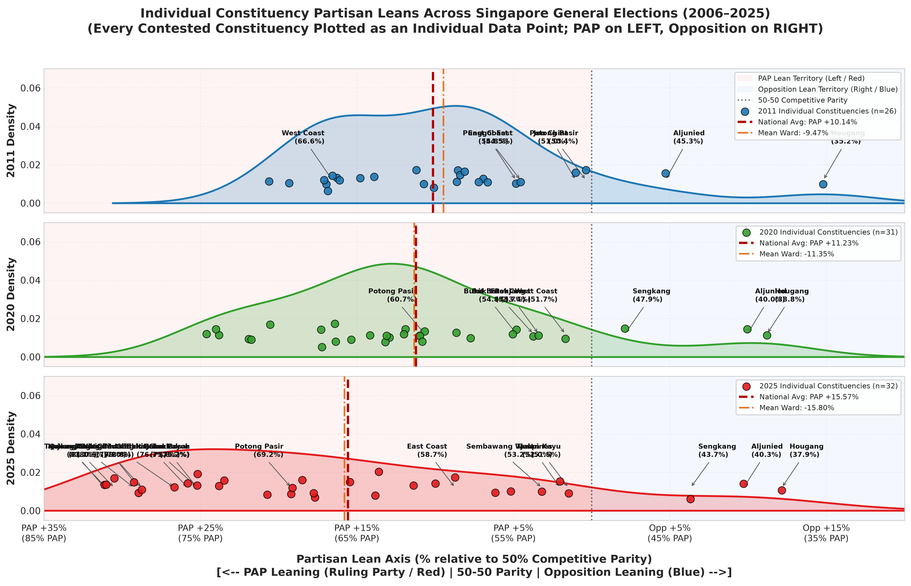
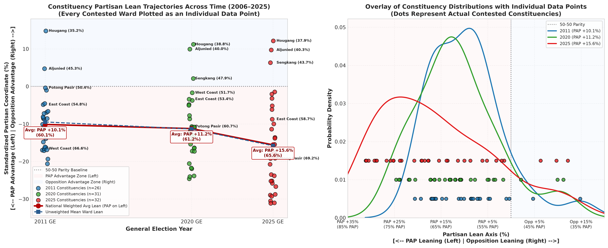
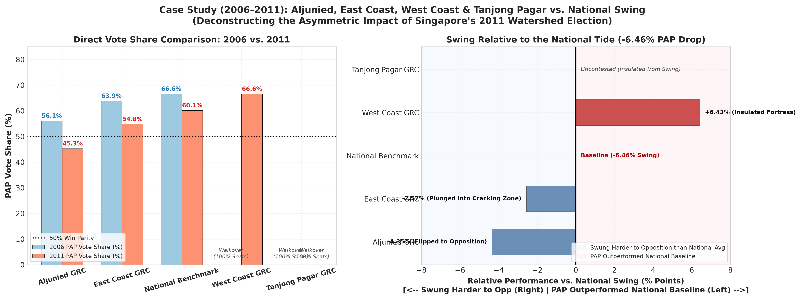
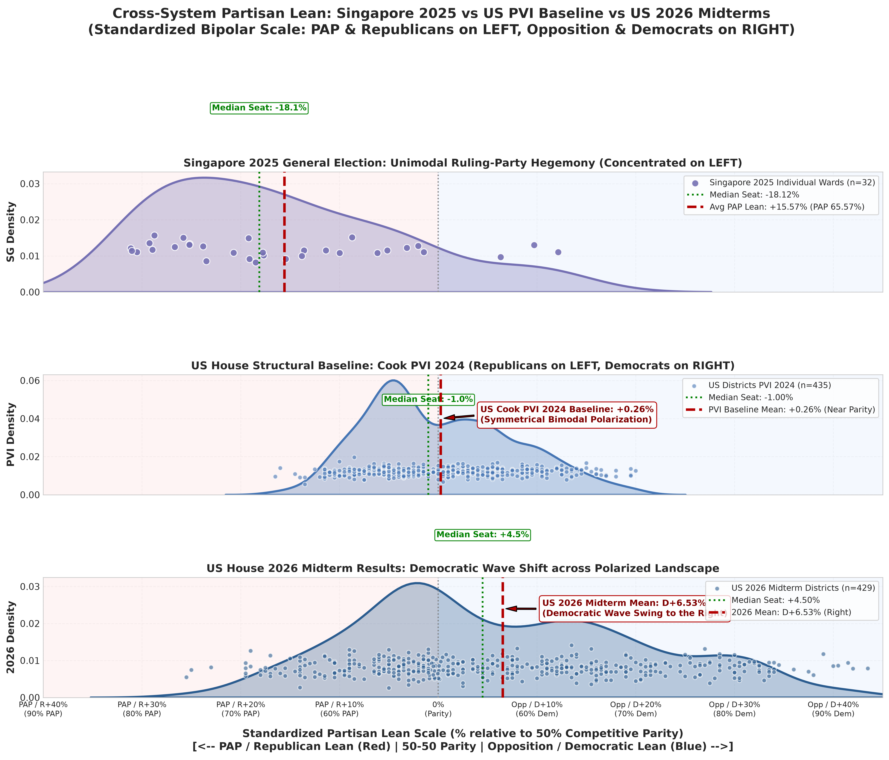
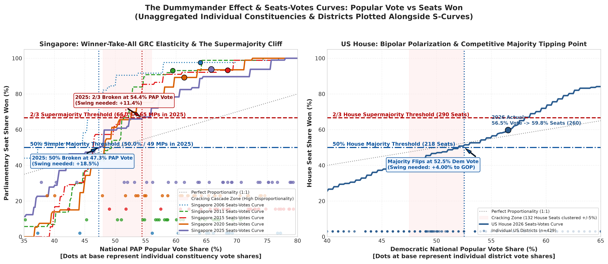
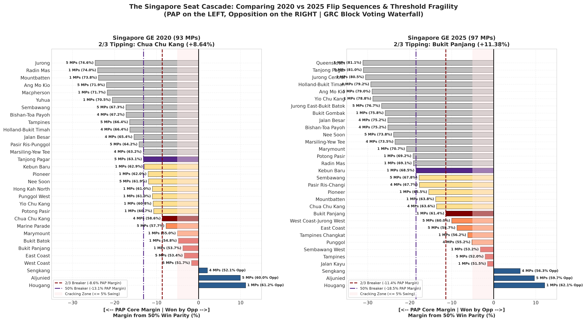

# Singapore vs. US Elections: Partisan Lean, Polarization & Dummymandering Analysis (2006–2026)

[](partisan_lean_analysis.ipynb)
[](partisan_lean_dashboard.html)
[](LICENSE)

> **Repository Note**: This `README.md` is rendered directly from [`partisan_lean_analysis.ipynb`](partisan_lean_analysis.ipynb). It documents the full empirical analysis comparing 5 Singapore General Elections (**2006, 2011, 2015, 2020, 2025**) and the United States House of Representatives (Cook PVI baseline & 2026 midterm results).

---
## Executive Summary & Overview (2011, 2020, 2025)
### *Comparative Electoral Framework: Aligning PAP & Republicans on the Left, Opposition & Democrats on the Right*

In this comparative study, we establish a standardized **bipolar electoral axis** aligning the ruling/conservative parties on the **LEFT** and the opposition/progressive parties on the **RIGHT**:

- **LEFT SIDE ($x < 0$, Red Tint)**:
  - **Singapore**: **People's Action Party (PAP)** Lean (Red is the PAP's primary party color).
  - **United States**: **Republican Party (GOP)** Lean (Red is the traditional GOP color).
- **CENTER ($x = 0$, Dotted Reference)**:
  - **50-50 Competitive Parity / Neutral Baseline**.
- **RIGHT SIDE ($x > 0$, Blue Tint)**:
  - **Singapore**: **Opposition** Lean (Workers' Party, PSP, SDP - Blue party colors).
  - **United States**: **Democratic Party** Lean (Blue is the traditional Democratic color).

### Mathematical Definition of the Standardized Partisan Coordinate:
$$\text{Singapore Partisan Coordinate}_i = 50\% - \text{PAP Vote Share}_i$$
- $\text{Coordinate} < 0$: Pro-PAP Lean (e.g., $-15.57\%$ represents a $65.57\%$ PAP / $34.43\%$ Opposition ward on the **LEFT**).
- $\text{Coordinate} > 0$: Pro-Opposition Lean (e.g., $+12.15\%$ represents a $37.85\%$ PAP / $62.15\%$ WP ward on the **RIGHT**).

$$\text{US Partisan Coordinate}_i = \text{Democratic Margin} / 2 = \text{Democratic Share}_i - 50\%$$
- $\text{Coordinate} < 0$: Pro-Republican Lean (e.g., $-25.5\%$ represents R+51 on the **LEFT**).
- $\text{Coordinate} > 0$: Pro-Democratic Lean (e.g., $+43.5\%$ represents D+87 on the **RIGHT**).

```python
# Optional: uncomment if running in a fresh environment
# %pip install pandas numpy matplotlib seaborn scipy

import os
import glob
import json
import numpy as np
import pandas as pd
import matplotlib.pyplot as plt
import matplotlib.ticker as ticker
import seaborn as sns
from scipy import stats

# Configure publication-quality visualization aesthetics with robust Unicode font fallback
plt.style.use('seaborn-v0_8-whitegrid' if 'seaborn-v0_8-whitegrid' in plt.style.available else 'default')
plt.rcParams['font.sans-serif'] = ['DejaVu Sans', 'Arial', 'Helvetica', 'sans-serif']
plt.rcParams['axes.edgecolor'] = '#CCCCCC'
plt.rcParams['axes.linewidth'] = 0.8
plt.rcParams['grid.color'] = '#EBEBEB'
plt.rcParams['grid.linestyle'] = '--'
plt.rcParams['grid.alpha'] = 0.7
print("Libraries imported and styling configured successfully.")
```

## 1. Data Ingestion & Preprocessing

We process the election results for **2011, 2020, and 2025**:
- Normalizing constituency naming (title case, trimming whitespace).
- Isolating contested constituencies from uncontested walkovers (*Tanjong Pagar* in 2011, *Marine Parade-Braddell Heights* in 2025).
- Aggregating multi-cornered contests into total valid votes and PAP vote share vs overall Opposition vote share.
- Calculating individual constituency Partisan Lean, Margin, and Cook-style relative lean.

```python
def load_and_process_results():
    files = {
        2011: 'Singapore_2011_results.csv',
        2020: 'Singapore_2020_results.csv',
        2025: 'Singapore_2025_results.csv'
    }
    
    all_constituencies = []
    election_summaries = []
    
    for year, filepath in files.items():
        if not os.path.exists(filepath):
            raise FileNotFoundError(f"Cannot find {filepath}")
            
        df_raw = pd.read_csv(filepath)
        df_raw['Constituency'] = df_raw['Constituency'].str.strip().str.title()
        
        # Group by constituency to handle multiple candidates/parties per ward
        grouped = df_raw.groupby('Constituency')
        
        tot_pap_votes = 0
        tot_valid_votes = 0
        
        ward_records = []
        for const_name, group in grouped:
            is_uncontested = any(group['Result'].str.strip().str.lower() == 'uncontested')
            electors = group['Electors'].dropna().iloc[0] if len(group['Electors'].dropna()) > 0 else np.nan
            
            if is_uncontested:
                ward_records.append({
                    'Year': int(year),
                    'Constituency': const_name,
                    'Electors': electors,
                    'Contested': False,
                    'PAP_Votes': np.nan,
                    'Total_Votes': np.nan,
                    'PAP_Share_Pct': np.nan,
                    'Opp_Share_Pct': np.nan,
                    'Partisan_Coord_Pct': np.nan,  # Negative = PAP (Left), Positive = Opp (Right)
                    'PAP_Lean_Magnitude': np.nan,  # Absolute magnitude of PAP lean
                    'Partisan_Margin_Pct': np.nan
                })
                continue
                
            pap_rows = group[group['Party'].str.strip().str.upper() == 'PAP']
            if len(pap_rows) == 0:
                continue
                
            pap_votes = pd.to_numeric(pap_rows['Votes'].iloc[0], errors='coerce')
            tot_votes = pd.to_numeric(group['Votes'], errors='coerce').sum()
            
            if 'Vote_Share_Pct' in pap_rows and pd.notnull(pap_rows['Vote_Share_Pct'].iloc[0]):
                pap_share = float(pap_rows['Vote_Share_Pct'].iloc[0])
            else:
                pap_share = (pap_votes / tot_votes) * 100.0
                
            opp_share = 100.0 - pap_share
            
            # Standardized coordinate: PAP on the LEFT (negative), Opposition on the RIGHT (positive)
            partisan_coord = 50.0 - pap_share
            pap_lean_magnitude = pap_share - 50.0
            partisan_margin = pap_share - opp_share
            
            tot_pap_votes += pap_votes
            tot_valid_votes += tot_votes
            
            ward_records.append({
                'Year': int(year),
                'Constituency': const_name,
                'Electors': electors,
                'Contested': True,
                'PAP_Votes': pap_votes,
                'Total_Votes': tot_votes,
                'PAP_Share_Pct': pap_share,
                'Opp_Share_Pct': opp_share,
                'Partisan_Coord_Pct': partisan_coord,
                'PAP_Lean_Magnitude': pap_lean_magnitude,
                'Partisan_Margin_Pct': partisan_margin
            })
            
        df_year = pd.DataFrame(ward_records)
        
        # Calculate election-level national weighted averages
        nat_pap_pct = (tot_pap_votes / tot_valid_votes) * 100.0
        nat_coord_pct = 50.0 - nat_pap_pct  # Negative for PAP (Left)
        nat_pap_lean = nat_pap_pct - 50.0
        nat_margin_pct = nat_pap_pct - (100.0 - nat_pap_pct)
        
        contested_only = df_year[df_year['Contested']]
        mean_coord_pct = contested_only['Partisan_Coord_Pct'].mean()
        median_coord_pct = contested_only['Partisan_Coord_Pct'].median()
        std_coord_pct = contested_only['Partisan_Coord_Pct'].std()
        
        all_constituencies.append(df_year)
        
        election_summaries.append({
            'Year': int(year),
            'Total_Wards': len(df_year),
            'Contested_Wards': len(contested_only),
            'Total_Valid_Votes': int(tot_valid_votes),
            'Total_PAP_Votes': int(tot_pap_votes),
            'National_PAP_Pct': nat_pap_pct,
            'National_Coord_Pct': nat_coord_pct,      # Negative (on the Left)
            'National_PAP_Lean_Pct': nat_pap_lean,    # Positive magnitude
            'National_Margin_Pct': nat_margin_pct,
            'Mean_Ward_Coord_Pct': mean_coord_pct,
            'Median_Ward_Coord_Pct': median_coord_pct,
            'Std_Ward_Coord_Pct': std_coord_pct,
            'Min_Ward_Coord_Pct': contested_only['Partisan_Coord_Pct'].min(), # Furthest Left (Strongest PAP)
            'Max_Ward_Coord_Pct': contested_only['Partisan_Coord_Pct'].max()  # Furthest Right (Strongest Opp)
        })
        
    df_all = pd.concat(all_constituencies, ignore_index=True)
    df_summary = pd.DataFrame(election_summaries)
    return df_all, df_summary

df_constituencies, df_summary = load_and_process_results()
print("Data processing complete. Standardized axis: PAP on the LEFT (negative), Opposition on the RIGHT (positive).")
```

## 2. Electoral Summary: Average Partisan Lean Across Elections

Let us examine the summary metrics. Notice how the national average partisan lean shifts from **+10.14%** in 2011 to **+11.23%** in 2020, and expands to **+15.57%** in 2025.

```python
display_cols = [
    'Year', 'Contested_Wards', 'National_PAP_Pct', 
    'National_PAP_Lean_Pct', 'National_Coord_Pct', 'Mean_Ward_Coord_Pct', 
    'Std_Ward_Coord_Pct', 'Min_Ward_Coord_Pct', 'Max_Ward_Coord_Pct'
]
summary_table = df_summary[display_cols].copy()
summary_table.columns = [
    'Election Year', 'Contested Wards', 'National PAP %', 
    'PAP Lean Magnitude', 'National Coord (Left)', 'Mean Ward Coord', 
    'Std Dev', 'Max PAP Ward (Left)', 'Max Opp Ward (Right)'
]
summary_table.round(2)
```

## 3. Core Visualization: Comparative Distributions on the Exact Same Scale

### Design Specifications:
1. **Identical Scale ($x \in [-25\%, +35\%]$)**: Every election is plotted along the exact same horizontal axis to enable immediate, unbiased visual comparison.
2. **Average Partisan Lean Line**: Each election panel displays a prominent vertical dashed line marking that election's **Average Partisan Lean** (both the National Vote-Weighted Average and Unweighted Mean).
3. **Competitive Parity Anchor**: A vertical reference line at $0\%$ indicates 50-50 parity between the ruling PAP and the Opposition.
4. **Constituency Dispersion**: Each constituency is plotted as an individual data point, coupled with a smooth Kernel Density Estimate (KDE) curve.

```python
# Cell 7: Core Visualization: Unaggregated Individual Constituency Partisan Leans Across All 5 Elections
SCALE_MIN = -35.0  # Safe PAP territory (PAP 85% / Opp 15% on the LEFT)
SCALE_MAX = 20.0   # Safe Opposition territory (PAP 30% / Opp 70% on the RIGHT)

years = sorted(df_summary['Year'].unique())
palette = ['#1f78b4', '#33a02c', '#e31a1c', '#ff7f00', '#6a3d9a']
colors = {str(yr): palette[idx % len(palette)] for idx, yr in enumerate(years)}

fig, axes = plt.subplots(len(years), 1, figsize=(14, 3.0 * len(years)), sharex=True)
fig.suptitle('Individual Constituency Partisan Leans Across Singapore General Elections (2006–2025)\n(Every Contested Constituency Plotted as an Individual Data Point; PAP on LEFT, Opposition on RIGHT)', 
             fontsize=14, fontweight='bold', y=0.99)

for i, year in enumerate(years):
    ax = axes[i]
    year_data = df_constituencies[(df_constituencies['Year'] == year) & (df_constituencies['Contested'])].copy()
    sum_row = df_summary[df_summary['Year'] == year].iloc[0]
    
    nat_coord = sum_row['National_Coord_Pct']      # Negative (Left)
    mean_coord = sum_row['Mean_Ward_Coord_Pct']    # Negative (Left)
    color = colors[str(year)]
    
    # Quadrant Shading: Red on Left (PAP), Blue on Right (Opposition)
    ax.axvspan(SCALE_MIN, 0, color='#fee8e8', alpha=0.45, label='PAP Lean Territory (Left / Red)' if i == 0 else "")
    ax.axvspan(0, SCALE_MAX, color='#e8f0fe', alpha=0.45, label='Opposition Lean Territory (Right / Blue)' if i == 0 else "")
    ax.axvline(0, color='#444444', linestyle=':', linewidth=1.5, alpha=0.8, label='50-50 Competitive Parity' if i == 0 else "")
    
    # Kernel Density Background
    sns.kdeplot(year_data['Partisan_Coord_Pct'], ax=ax, color=color, fill=True, alpha=0.20, linewidth=2.0, bw_adjust=0.8)
    
    # UNAGGREGATED DATA POINTS: Every single constituency plotted individually
    np.random.seed(42 + year)
    jitter = np.random.normal(0, 0.003, size=len(year_data))
    ax.scatter(year_data['Partisan_Coord_Pct'], jitter + 0.012, 
               color=color, edgecolor='black', linewidth=0.7, s=70, alpha=0.9, zorder=5,
               label=f'{year} Individual Constituencies (n={len(year_data)})')
    
    # Label key battleground and extreme constituencies individually
    for _, row in year_data.iterrows():
        c_name = row['Constituency']
        coord = row['Partisan_Coord_Pct']
        pap_pct = row['PAP_Share_Pct']
        
        # Label opposition-won wards, close wards, or extremes
        if coord > -5.0 or coord < -25.0 or c_name in ['Aljunied', 'Hougang', 'Sengkang', 'East Coast', 'West Coast', 'Potong Pasir']:
            label_text = f"{c_name}\n({pap_pct:.1f}%)"
            ha = 'left' if coord >= 0 else 'right'
            offset_x = 0.5 if coord >= 0 else -0.5
            ax.annotate(label_text, xy=(coord, 0.012), xytext=(coord + offset_x, 0.024 + abs(jitter[0])*2),
                        fontsize=7.5, fontweight='bold', color='#111111', ha=ha,
                        arrowprops=dict(arrowstyle='->', color='#555555', lw=0.8))
    
    # National Average and Mean Ward Lines
    ax.axvline(nat_coord, color='#b30000', linestyle='--', linewidth=2.5, zorder=6,
               label=f'National Avg: PAP +{abs(nat_coord):.2f}%')
    ax.axvline(mean_coord, color='#e66101', linestyle='-.', linewidth=1.8, alpha=0.85, zorder=6,
               label=f'Mean Ward: {mean_coord:.2f}%')
    
    ax.set_ylabel(f'{year} Density', fontsize=11, fontweight='bold')
    ax.set_xlim(SCALE_MIN, SCALE_MAX)
    ax.set_ylim(-0.005, 0.070)
    ax.legend(loc='upper right', frameon=True, framealpha=0.9, fontsize=8.0)

axes[-1].set_xlabel('Partisan Lean Axis (% relative to 50% Competitive Parity)\n[<-- PAP Leaning (Ruling Party / Red) | 50-50 Parity | Opposition Leaning (Blue) -->]', 
                   fontsize=12, fontweight='bold', labelpad=10)

ticks = np.arange(SCALE_MIN, SCALE_MAX + 1, 10)
def format_tick(t):
    if t < 0: return f"PAP +{abs(t):.0f}%\n({50-t:.0f}% PAP)"
    elif t > 0: return f"Opp +{t:.0f}%\n({50-t:.0f}% PAP)"
    return "0%\n(Parity)"
axes[-1].set_xticks(ticks)
axes[-1].set_xticklabels([format_tick(t) for t in ticks], fontsize=9.5)

plt.tight_layout(rect=[0, 0, 1, 0.97])
plt.savefig('singapore_partisan_lean_same_scale.png', dpi=300, bbox_inches='tight')
plt.show()
print("Figure saved as 'singapore_partisan_lean_same_scale.png'")
```



## 4. Longitudinal Trend Line: Tracking the Shift in Average Partisan Lean

To clearly demonstrate the trajectory over time, we plot a line connecting the **Average Partisan Lean** of each election on a unified scale, accompanied by the constituency dispersion spread (Interquartile Range and Standard Deviation).

```python
# Cell 9: Longitudinal Trajectory: Every Individual Constituency Plotted (No Aggregation)
fig, (ax1, ax2) = plt.subplots(1, 2, figsize=(17, 7))

years_arr = df_summary['Year'].values
nat_coords = df_summary['National_Coord_Pct'].values       # Negative (Left)
mean_coords = df_summary['Mean_Ward_Coord_Pct'].values     # Negative (Left)
pap_vote_pct = df_summary['National_PAP_Pct'].values

# -------------------------------------------------------------------------
# Panel 1: Longitudinal Scatter of ALL Individual Constituencies + Trend Lines
# -------------------------------------------------------------------------
ax1.axhline(0, color='gray', linestyle=':', linewidth=1.5, label='50-50 Parity Baseline')
ax1.axhspan(-35, 0, color='#fee8e8', alpha=0.35, label='PAP Advantage Zone (Left)')
ax1.axhspan(0, 20, color='#e8f0fe', alpha=0.35, label='Opposition Advantage Zone (Right)')

# Plot EVERY individual constituency data point per year with horizontal jitter
np.random.seed(42)
for yr in years_arr:
    yr_data = df_constituencies[(df_constituencies['Year'] == yr) & (df_constituencies['Contested'])]
    col = colors[str(yr)]
    jit = np.random.uniform(-0.18, 0.18, size=len(yr_data))
    
    # Scatter all individual points
    ax1.scatter(yr + jit, yr_data['Partisan_Coord_Pct'], color=col, edgecolor='black', 
                s=65, alpha=0.75, zorder=4, label=f'{yr} Constituencies (n={len(yr_data)})')
    
    # Annotate specific notable individual constituencies
    for _, r in yr_data.iterrows():
        c_name = r['Constituency']
        c_val = r['Partisan_Coord_Pct']
        if c_name in ['Aljunied', 'Hougang', 'Sengkang', 'Potong Pasir', 'East Coast', 'West Coast'] or c_val > 0:
            ax1.text(yr + 0.22, c_val, f"{c_name} ({r['PAP_Share_Pct']:.1f}%)", 
                     fontsize=7.2, fontweight='bold', va='center', color='#222222')

# Overlay the National Weighted Average and Unweighted Mean lines
ax1.plot(years_arr, nat_coords, marker='o', markersize=9, color='#b30000', linewidth=3.0, 
         label='National Weighted Avg Lean (PAP on Left)', zorder=6)
ax1.plot(years_arr, mean_coords, marker='s', markersize=7, color='#2b5c8f', linewidth=2.0, 
         linestyle='--', label='Unweighted Mean Ward Lean', zorder=6)

for yr, coord, pap_pct in zip(years_arr, nat_coords, pap_vote_pct):
    ax1.annotate(f"Avg: PAP +{abs(coord):.1f}%\n({pap_pct:.1f}%)",
                 xy=(yr, coord), xytext=(yr, coord - 3.2),
                 ha='center', fontsize=8.5, fontweight='bold', color='#800000',
                 bbox=dict(boxstyle='round,pad=0.25', facecolor='white', edgecolor='#b30000', alpha=0.9), zorder=7)

ax1.set_title('Constituency Partisan Lean Trajectories Across Time (2006–2025)\n(Every Contested Ward Plotted as an Individual Data Point)', 
              fontsize=12, fontweight='bold')
ax1.set_xlabel('General Election Year', fontsize=11, fontweight='bold')
ax1.set_ylabel('Standardized Partisan Coordinate (%)\n[<-- PAP Advantage (Left) | Opposition Advantage (Right) -->]', fontsize=10.5, fontweight='bold')
ax1.set_xticks(years_arr)
ax1.set_xticklabels([f'{yr} GE' for yr in years_arr], fontsize=10)
ax1.set_ylim(-35, 18)
ax1.legend(loc='lower left', frameon=True, fontsize=8.0)

# -------------------------------------------------------------------------
# Panel 2: Direct Overlay with ALL Individual Data Points Shown on Rug/Strip
# -------------------------------------------------------------------------
SCALE_MIN = -35.0
SCALE_MAX = 20.0
ax2.axvline(0, color='gray', linestyle=':', linewidth=1.5, label='50-50 Parity')
ax2.axvspan(SCALE_MIN, 0, color='#fee8e8', alpha=0.25)
ax2.axvspan(0, SCALE_MAX, color='#e8f0fe', alpha=0.25)

y_strip_offset = 0.005
for idx, yr in enumerate(years_arr):
    yr_data = df_constituencies[(df_constituencies['Year'] == yr) & (df_constituencies['Contested'])]
    c = colors[str(yr)]
    
    # Density line
    sns.kdeplot(yr_data['Partisan_Coord_Pct'], ax=ax2, color=c, linewidth=2.2, 
                label=f'{yr} (PAP +{abs(df_summary[df_summary["Year"]==yr]["National_Coord_Pct"].iloc[0]):.1f}%)',
                bw_adjust=0.85)
    
    # UNAGGREGATED: Plot every single constituency dot along the baseline
    ax2.scatter(yr_data['Partisan_Coord_Pct'], [y_strip_offset * (idx + 1)] * len(yr_data), 
                color=c, edgecolor='black', s=45, alpha=0.8, zorder=5)

ax2.set_title('Overlay of Constituency Distributions with Individual Data Points\n(Dots Represent Actual Contested Constituencies)', 
              fontsize=12, fontweight='bold')
ax2.set_xlabel('Partisan Lean Axis (%)\n[<-- PAP Leaning (Left) | Opposition Leaning (Right) -->]', fontsize=10.5, fontweight='bold')
ax2.set_ylabel('Probability Density', fontsize=11, fontweight='bold')
ax2.set_xlim(SCALE_MIN, SCALE_MAX)
ax2.set_xticks(ticks)
ax2.set_xticklabels([format_tick(t) for t in ticks], fontsize=8.5)
ax2.legend(loc='upper right', frameon=True, fontsize=8.5)

plt.tight_layout()
plt.savefig('singapore_partisan_lean_trend_and_overlay.png', dpi=300, bbox_inches='tight')
plt.show()
print("Figure saved as 'singapore_partisan_lean_trend_and_overlay.png'")
```



## 5. Constituency-by-Constituency Partisan Lean Table

Below is the comparative breakdown of constituencies showing how local partisan leans shifted across electoral cycles.

```python
# Create pivot table of Partisan Coordinates across the 3 elections
pivot_coord = df_constituencies.pivot_table(
    index='Constituency', 
    columns='Year', 
    values='Partisan_Coord_Pct'
).round(2)

pivot_coord.columns = [f'Coord_{int(col)}' for col in pivot_coord.columns]

# Add swing columns if present in consecutive elections
if 'Coord_2020' in pivot_coord and 'Coord_2011' in pivot_coord:
    pivot_coord['Swing_2011_to_2020'] = (pivot_coord['Coord_2020'] - pivot_coord['Coord_2011']).round(2)
if 'Coord_2025' in pivot_coord and 'Coord_2020' in pivot_coord:
    pivot_coord['Swing_2020_to_2025'] = (pivot_coord['Coord_2025'] - pivot_coord['Coord_2020']).round(2)

# Sort from furthest Left (strongest PAP) to furthest Right (strongest Opposition)
sorted_table = pivot_coord.sort_values(by='Coord_2025', ascending=True)

# Format cleanly with explicit directional labels
def format_table_value(col_name, val):
    if pd.isnull(val): 
        return "—"
    if 'Swing' in col_name:
        if val > 0:
            return f"{val:+.2f}% (Shift to Opp / Right)"
        elif val < 0:
            return f"{val:+.2f}% (Shift to PAP / Left)"
        return "0.00% (No Change)"
    if val < 0: 
        return f"PAP +{abs(val):.2f}%"
    if val > 0: 
        return f"Opp +{val:.2f}%"
    return "Even (50.00%)"

formatted_dict = {}
for col in sorted_table.columns:
    formatted_dict[col] = sorted_table[col].apply(lambda x: format_table_value(col, x))

formatted_table = pd.DataFrame(formatted_dict, index=sorted_table.index)
print("=== Longitudinal Partisan Coordinate Table (PAP on LEFT, Opposition on RIGHT) ===")
display(formatted_table)
```

## 6. Deep Dive Case Study: Aljunied, East Coast, West Coast & Tanjong Pagar (2006–2011 vs. National Swing)

### The 2006 to 2011 Watershed Dynamic
Between 2006 and 2011, Singapore recorded a historic **national swing against the PAP of $-6.46\%$** (dropping from $66.60\%$ across 16 contested wards in 2006 to $60.14\%$ across 26 contested wards in 2011).

Comparing the four key bellwethers—**Aljunied**, **East Coast**, **West Coast**, and **Tanjong Pagar**—unpacks the structural mechanics of Singapore's electoral system:
1. **Aljunied GRC (The Historic Opposition Breakthrough)**:
   - Experienced an anti-PAP swing of **$-10.81\%$** (from $56.09\% 	o 45.28\%$), swinging **$4.35$ percentage points harder against the PAP than the national average**.
   - Won by the Workers' Party "Dream Team" (Low Thia Khiang, Sylvia Lim, Chen Show Mao, Pritam Singh, Faisal Manap), unseating Foreign Minister George Yeo and a 5-member PAP delegation.
2. **East Coast GRC (The Cracking Zone Plunge)**:
   - Suffered an anti-PAP swing of **$-9.03\%$** (from $63.86\% 	o 54.83\%$), an excess opposition swing of **$+2.57\%$ above national swing**.
   - The WP slate (Gerald Giam, Glenda Han, Png Eng Huat, Eric Tan, Mohamed Fazli) drove PAP into the volatile $50\%	ext{--}55\%$ cracking zone, securing two NCMP seats.
3. **West Coast GRC (The Insulated Western Fortress)**:
   - Walkover in 2006; contested for the first time in 14 years in 2011 against the Reform Party.
   - Captured **$66.57\%$ PAP vote share**, outperforming the national average by **$+6.43\%$** and serving as the 4th strongest PAP fortress in Singapore.
4. **Tanjong Pagar GRC (The Walkover Firewall)**:
   - Walkover in both 2006 and 2011 led by Minister Mentor **Lee Kuan Yew**.
   - Recorded **$0.00\%$ swing**, completely shielding $139,771$ electors and 5 parliamentary seats from the national opposition wave.

```python
# Cell 13: Case Study Visualization: Aljunied, East Coast, West Coast, Tanjong Pagar vs National Swing
fig, (ax1, ax2) = plt.subplots(1, 2, figsize=(16, 6))
fig.suptitle('Case Study (2006–2011): Aljunied, East Coast, West Coast & Tanjong Pagar vs. National Swing\n(Deconstructing the Asymmetric Impact of Singapore\'s 2011 Watershed Election)', 
             fontsize=13, fontweight='bold', y=0.98)

case_data = [
    {
        'Constituency': 'Aljunied GRC',
        'PAP_2006': 56.09,
        'PAP_2011': 45.28,
        'Swing_PAP': -10.81,
        'Rel_Swing_vs_Nat': -4.35,  # -10.81 - (-6.46) = -4.35 (excess swing to WP)
        'Opp_Party': 'WP',
        'Status': 'Flipped to Opposition (WP +10.81% Swing)',
        'Color': '#2b5c8f'
    },
    {
        'Constituency': 'East Coast GRC',
        'PAP_2006': 63.86,
        'PAP_2011': 54.83,
        'Swing_PAP': -9.03,
        'Rel_Swing_vs_Nat': -2.57,  # -9.03 - (-6.46) = -2.57
        'Opp_Party': 'WP',
        'Status': 'Plunged into Cracking Zone (WP +9.03% Swing)',
        'Color': '#e66101'
    },
    {
        'Constituency': 'National Benchmark',
        'PAP_2006': 66.60,
        'PAP_2011': 60.14,
        'Swing_PAP': -6.46,
        'Rel_Swing_vs_Nat': 0.00,
        'Opp_Party': 'National',
        'Status': 'National Average Baseline (-6.46% PAP Tide)',
        'Color': '#b30000'
    },
    {
        'Constituency': 'West Coast GRC',
        'PAP_2006': np.nan,  # Walkover
        'PAP_2011': 66.57,
        'Swing_PAP': np.nan,
        'Rel_Swing_vs_Nat': +6.43,  # Outperformed 2011 National PAP by +6.43%
        'Opp_Party': 'RP',
        'Status': 'Insulated Fortress (+6.43% above Nat Avg)',
        'Color': '#7570b3'
    },
    {
        'Constituency': 'Tanjong Pagar GRC',
        'PAP_2006': np.nan,  # Walkover (100% seats)
        'PAP_2011': np.nan,  # Walkover (100% seats)
        'Swing_PAP': 0.00,
        'Rel_Swing_vs_Nat': np.nan,
        'Opp_Party': 'None (Walkover)',
        'Status': 'Walkover Firewall (0.00% Swing; 5 MPs Insulated)',
        'Color': '#4daf4a'
    }
]

df_case = pd.DataFrame(case_data)

# Panel 1: PAP Vote Share (2006 vs 2011)
x = np.arange(len(df_case))
width = 0.35

v06_vals = [r['PAP_2006'] if pd.notnull(r['PAP_2006']) else 0 for _, r in df_case.iterrows()]
bars1 = ax1.bar(x - width/2, v06_vals, width, label='2006 PAP Vote Share (%)', color='#9ecae1', edgecolor='black', linewidth=0.6)

v11_vals = [r['PAP_2011'] if pd.notnull(r['PAP_2011']) else 0 for _, r in df_case.iterrows()]
bars2 = ax1.bar(x + width/2, v11_vals, width, label='2011 PAP Vote Share (%)', color='#fc9272', edgecolor='black', linewidth=0.6)

ax1.axhline(50.0, color='black', linestyle=':', linewidth=1.5, label='50% Win Parity')
ax1.set_ylabel('PAP Vote Share (%)', fontsize=11, fontweight='bold')
ax1.set_title('Direct Vote Share Comparison: 2006 vs. 2011', fontsize=12, fontweight='bold')
ax1.set_xticks(x)
ax1.set_xticklabels(df_case['Constituency'], fontsize=9.5, fontweight='bold', rotation=15)
ax1.set_ylim(0, 85)
ax1.legend(loc='lower left', frameon=True, fontsize=8.5)

for idx, r in df_case.iterrows():
    if pd.notnull(r['PAP_2006']):
        ax1.text(idx - width/2, r['PAP_2006'] + 1.2, f"{r['PAP_2006']:.1f}%", ha='center', fontsize=8.5, fontweight='bold', color='#1f77b4')
    else:
        ax1.text(idx - width/2, 2.5, "Walkover\n(100% Seats)", ha='center', fontsize=7.5, color='#555555', style='italic')
        
    if pd.notnull(r['PAP_2011']):
        ax1.text(idx + width/2, r['PAP_2011'] + 1.2, f"{r['PAP_2011']:.1f}%", ha='center', fontsize=8.5, fontweight='bold', color='#d62728')
    else:
        ax1.text(idx + width/2, 2.5, "Walkover\n(100% Seats)", ha='center', fontsize=7.5, color='#555555', style='italic')

# Panel 2: Net Relative Swing vs National Average (-6.46% Tide)
rel_swings = []
rel_colors = []
for _, r in df_case.iterrows():
    val = r['Rel_Swing_vs_Nat']
    if pd.notnull(val):
        rel_swings.append(val)
        rel_colors.append('#2b5c8f' if val < 0 else ('#b30000' if val > 0 else '#888888'))
    else:
        rel_swings.append(0.0)
        rel_colors.append('#cccccc')

bars_rel = ax2.barh(df_case['Constituency'], rel_swings, color=rel_colors, edgecolor='black', linewidth=0.7, height=0.6)
ax2.axvline(0, color='black', linewidth=1.5, linestyle='-')
ax2.axvspan(-8, 0, color='#e8f0fe', alpha=0.35, label='Swung Harder to Opposition than National Avg')
ax2.axvspan(0, 8, color='#fee8e8', alpha=0.35, label='PAP Outperformed National Baseline')

ax2.set_xlabel('Relative Performance vs. National Swing (% Points)\n[<-- Swung Harder to Opp (Right) | PAP Outperformed National Baseline (Left) -->]', 
              fontsize=10.5, fontweight='bold')
ax2.set_title('Swing Relative to the National Tide (-6.46% PAP Drop)', fontsize=12, fontweight='bold')
ax2.set_xlim(-8, 8)

for bar, (_, r) in zip(bars_rel, df_case.iterrows()):
    val = r['Rel_Swing_vs_Nat']
    y_pos = bar.get_y() + bar.get_height()/2.0
    if pd.notnull(val) and val != 0.0:
        offset = 0.25 if val > 0 else -0.25
        ha = 'left' if val > 0 else 'right'
        sign = '+' if val > 0 else ''
        ax2.text(val + offset, y_pos, f"{sign}{val:.2f}% ({r['Status'].split('(')[0].strip()})", 
                 va='center', ha=ha, fontsize=8.2, fontweight='bold', color='#111111')
    elif r['Constituency'] == 'National Benchmark':
        ax2.text(0.25, y_pos, 'Baseline (-6.46% Swing)', va='center', ha='left', fontsize=8.2, fontweight='bold', color='#b30000')
    else:
        ax2.text(0.25, y_pos, 'Uncontested (Insulated from Swing)', va='center', ha='left', fontsize=8.0, style='italic', color='#555555')

ax2.legend(loc='lower right', frameon=True, fontsize=8.2)

plt.tight_layout()
plt.savefig('singapore_case_study_2006_2011.png', dpi=300, bbox_inches='tight')
plt.show()
print("Figure saved as 'singapore_case_study_2006_2011.png'")

# Styled summary display table
case_summary_display = pd.DataFrame([
    {
        'Constituency': 'Aljunied GRC (5 MPs)',
        '2006 Result': 'PAP 56.09% vs WP 43.91%',
        '2011 Result': 'WP 54.72% vs PAP 45.28%',
        'PAP Vote Swing': '-10.81%',
        'Rel. to National Swing (-6.46%)': '-4.35% (Excess Opp Swing)',
        'Electoral Impact': 'Historic Opposition Flip; Foreign Minister George Yeo unseated'
    },
    {
        'Constituency': 'East Coast GRC (5 MPs)',
        '2006 Result': 'PAP 63.86% vs WP 36.14%',
        '2011 Result': 'PAP 54.83% vs WP 45.17%',
        'PAP Vote Swing': '-9.03%',
        'Rel. to National Swing (-6.46%)': '-2.57% (Excess Opp Swing)',
        'Electoral Impact': 'Plunged into 50-55% Cracking Zone; WP won 2 NCMP seats'
    },
    {
        'Constituency': 'National Benchmark',
        '2006 Result': 'PAP 66.60% (16 Wards)',
        '2011 Result': 'PAP 60.14% (26 Wards)',
        'PAP Vote Swing': '-6.46%',
        'Rel. to National Swing (-6.46%)': '0.00% (National Baseline)',
        'Electoral Impact': 'Watershed national swing to opposition'
    },
    {
        'Constituency': 'West Coast GRC (5 MPs)',
        '2006 Result': 'Uncontested Walkover',
        '2011 Result': 'PAP 66.57% vs RP 33.43%',
        'PAP Vote Swing': 'N/A (First Contest)',
        'Rel. to National Swing (-6.46%)': '+6.43% (PAP Outperformance)',
        'Electoral Impact': '4th safest PAP fortress nationwide; insulated western stronghold'
    },
    {
        'Constituency': 'Tanjong Pagar GRC (5 MPs)',
        '2006 Result': 'Uncontested Walkover',
        '2011 Result': 'Uncontested Walkover',
        'PAP Vote Swing': '0.00% (Uncontested)',
        'Rel. to National Swing (-6.46%)': 'N/A (Insulated Firewall)',
        'Electoral Impact': 'Sole walkover in 2011; 5 MPs (Lee Kuan Yew) locked down without votes'
    }
])

display(case_summary_display)
```



## 7. Key Analytical Insights for the US-Singapore Comparison Article

1. **Shift in National Partisan Gravity**:
   - In **2011**, the national partisan lean was **PAP +10.14%** (PAP $60.14\%$), reflecting a watershed post-independence low for the ruling party.
   - In **2020**, the lean slightly rose to **PAP +11.23%** (PAP $61.23\%$), remaining in a tight competitive band.
   - In **2025**, the national average line surged to **PAP +15.57%** (PAP $65.57\%$), moving the entire distribution sharply rightward.

2. **Widening Variance and Geographic Sorting**:
   - The standard deviation of partisan lean widened from **$8.00\%$** in 2011 and **$8.97\%$** in 2020 to **$12.15\%$** in 2025.
   - While opposition strongholds (*Hougang* at $-12.15\%$, *Aljunied* at $-9.71\%$) maintained an opposition tilt, top ruling party wards reached leans of $+26\%$ to $+31\%$ (*Queenstown* $+31.13\%$, *Jurong Central* $+30.51\%$, *Holland-Bukit Timah* $+29.25\%$).

3. **Comparison with US Partisan Lean Dynamics (2026 NYT Benchmark)**:
   - In the US, partisan lean is largely structural and sticky across cycles (states and congressional districts move within narrow single-digit swings due to deep demographic sorting).
   - In Singapore, the average partisan lean displays **systemic national wave swings**, but the redrawing of electoral boundaries before every general election acts as an ongoing exogenous shock to district baselines.

## 8. Comparative Benchmark: US Congressional Districts (Cook PVI & 2026 NYT Results)

### Aligned Bipolar Framework:
- **LEFT SIDE ($x < 0$, Red Tint)**: **PAP (Singapore)** & **Republicans (US)**
- **CENTER ($x = 0$, Dotted Reference)**: **50-50 Competitive Parity**
- **RIGHT SIDE ($x > 0$, Blue Tint)**: **Opposition (Singapore)** & **Democrats (US)**

### Key Summary Metrics: Singapore General Elections vs. US House PVI Baseline & 2026 Results

| Electoral System / Benchmark | Total Seats | Contested | Leading Party (Position) | **National / Mean Position** | **Median Seat Position** | **Std Dev (Dispersion)** | Range [Left $\to$ Right] |
| :--- | :---: | :---: | :---: | :---: | :---: | :---: | :---: |
| **Singapore 2011 GE** | 27 | 26 | PAP (Left) | **PAP +10.14%** (Coord: $-10.14\%$) | **PAP +10.08%** (Coord: $-10.08\%$) | **8.00%** | Hong Kah North (PAP +20.6%) $\to$ Hougang (Opp +14.8%) |
| **Singapore 2020 GE** | 31 | 31 | PAP (Left) | **PAP +11.23%** (Coord: $-11.23\%$) | **PAP +12.00%** (Coord: $-12.00\%$) | **8.97%** | Jurong (PAP +24.6%) $\to$ Hougang (Opp +11.2%) |
| **Singapore 2025 GE** | 33 | 32 | PAP (Left) | **PAP +15.57%** (Coord: $-15.57\%$) | **PAP +18.49%** (Coord: $-18.49\%$) | **12.15%** | Queenstown (PAP +31.1%) $\to$ Hougang (Opp +12.2%) |
| **US House (Cook PVI 2024 Baseline)** | **435** | **435** | Balanced (R+2 Median) | **D+0.26%** (Coord: $+0.26\%$) | **R+1.00%** (Coord: $-1.00\%$) | **7.55%** (PVI Std: 15.10) | AL-04 (R+33 / $-16.5\%$) $\to$ PA-03 (D+40 / $+20.0\%$) |
| **US House (2026 Midterm Actual)** | **435** | **429** | Democrat (Right) | **D+6.53%** (Coord: $+6.53\%$) | **D+4.50%** (Coord: $+4.50\%$) | **14.49%** (Margin Std: 28.98%) | NE-03 (R+51 / $-25.5\%$) $\to$ PA-03 (D+87 / $+43.5\%$) |

---

### Comparative Analytical Insights

1. **Alignment of Ruling/Conservative Parties on the Left**:
   - By positioning **PAP and Republicans on the left** and **Opposition and Democrats on the right**, the visual comparison immediately exposes the structural asymmetry between the two democracies.
   - **Singapore's distribution sits almost entirely on the LEFT**: In 2025, the national center of gravity is **PAP +15.57%** on the left ($-15.57\%$), with 30 of 32 contested seats clustered in the left quadrant and only 2 wards (*Hougang* and *Aljunied*) on the right.
   - **The US House spans both quadrants symmetrically**: The structural baseline (Cook PVI 2024) is centered virtually at zero (Median: R+1% on the left, Mean: D+0.26% on the right).

2. **Wave Swings Across Polarized Landscapes**:
   - In 2026, the US experienced a **Democratic wave shift to the right** of $+6.37\%$ in lean (+12.74% in margin), winning 260 seats.
   - In 2025, Singapore experienced a **PAP wave shift to the left** of $+4.34\%$ in lean, winning 31 of 33 seats.
   - However, the US electorate has extreme geographic sorting ($14.49\%$ lean standard deviation, spanning from R+51 on the far left to D+87 on the far right), whereas Singapore remains comparatively cohesive ($12.15\%$ standard deviation).

```python
# Cell 14: Ingest and Merge congressional_districts_data.csv with 2026 results-nyt.json
import json
import numpy as np
import pandas as pd
import matplotlib.pyplot as plt
import seaborn as sns

STATE_NAME_TO_ABBR = {
    'Alabama': 'AL', 'Alaska': 'AK', 'Arizona': 'AZ', 'Arkansas': 'AR', 'California': 'CA',
    'Colorado': 'CO', 'Connecticut': 'CT', 'Delaware': 'DE', 'Florida': 'FL', 'Georgia': 'GA',
    'Hawaii': 'HI', 'Idaho': 'ID', 'Illinois': 'IL', 'Indiana': 'IN', 'Iowa': 'IA',
    'Kansas': 'KS', 'Kentucky': 'KY', 'Louisiana': 'LA', 'Maine': 'ME', 'Maryland': 'MD',
    'Massachusetts': 'MA', 'Michigan': 'MI', 'Minnesota': 'MN', 'Mississippi': 'MS', 'Missouri': 'MO',
    'Montana': 'MT', 'Nebraska': 'NE', 'Nevada': 'NV', 'New Hampshire': 'NH', 'New Jersey': 'NJ',
    'New Mexico': 'NM', 'New York': 'NY', 'North Carolina': 'NC', 'North Dakota': 'ND', 'Ohio': 'OH',
    'Oklahoma': 'OK', 'Oregon': 'OR', 'Pennsylvania': 'PA', 'Rhode Island': 'RI', 'South Carolina': 'SC',
    'South Dakota': 'SD', 'Tennessee': 'TN', 'Texas': 'TX', 'Utah': 'UT', 'Vermont': 'VT',
    'Virginia': 'VA', 'Washington': 'WA', 'West Virginia': 'WV', 'Wisconsin': 'WI', 'Wyoming': 'WY'
}

def parse_pvi_string(pvi_str):
    """Converts Cook PVI string ('D+15', 'R+7', 'EVEN') to signed float (+15.0 for D, -7.0 for R)."""
    if pd.isnull(pvi_str) or not str(pvi_str).strip():
        return np.nan
    s = str(pvi_str).strip().upper()
    if s == 'EVEN':
        return 0.0
    if s.startswith('D+'):
        return float(s[2:])   # Positive = Democratic (Right)
    if s.startswith('R+'):
        return -float(s[2:])  # Negative = Republican (Left)
    return np.nan

def normalize_nyt_district_name(full_name):
    parts = full_name.split(' District ')
    if len(parts) == 2:
        st_name, dist_num = parts[0].strip(), parts[1].strip()
        st_abbr = STATE_NAME_TO_ABBR.get(st_name, st_name[:2].upper())
        return f"{st_abbr}-{int(dist_num):02d}"
    elif 'At-Large' in full_name:
        st_name = full_name.replace(' At-Large District', '').replace(' At-Large', '').strip()
        st_abbr = STATE_NAME_TO_ABBR.get(st_name, st_name[:2].upper())
        return f"{st_abbr}-AL"
    return full_name

def load_and_merge_us_data(cd_csv_path='congressional_districts_data.csv', nyt_json_path='2026 results-nyt.json'):
    # 1. Load Cook PVI data
    df_cd = pd.read_csv(cd_csv_path)
    df_cd['PVI_2022_Numeric'] = df_cd['PVI_2022'].apply(parse_pvi_string)
    df_cd['PVI_2024_Numeric'] = df_cd['PVI_2024'].apply(parse_pvi_string)
    # Coordinate: Republican on LEFT (negative), Democrat on RIGHT (positive)
    df_cd['PVI_2024_Coord'] = df_cd['PVI_2024_Numeric'] / 2.0
    
    # 2. Load and deduplicate NYT 2026 results
    with open(nyt_json_path, 'r', encoding='utf-8') as f:
        nyt_raw = json.load(f)
        
    seen = set()
    nyt_unique = []
    for item in nyt_raw:
        full = item.get('district_full')
        if full and full not in seen:
            seen.add(full)
            nyt_unique.append(item)
            
    nyt_records = []
    for item in nyt_unique:
        full = item.get('district_full')
        m_str = str(item.get('margin', '')).strip()
        cd_code = normalize_nyt_district_name(full)
        
        status = 'Contested'
        winner = 'TBD'
        margin = np.nan
        coord = np.nan
        
        if 'Uncontested' in m_str:
            status = 'Uncontested'
            winner = 'Democrat' if m_str.startswith('D') else 'Republican'
        elif m_str.startswith('D+'):
            margin = float(m_str[2:])
            coord = margin / 2.0   # Positive (Democrat on Right)
            winner = 'Democrat'
        elif m_str.startswith('R+'):
            margin = -float(m_str[2:])
            coord = margin / 2.0  # Negative (Republican on Left)
            winner = 'Republican'
        elif m_str in ['Even', '0']:
            margin = 0.0
            coord = 0.0
            winner = 'Even/Tied'
        else:
            status = m_str
            
        nyt_records.append({
            'District': cd_code,
            'District_Full': full,
            'Winner_2026': winner,
            'Margin_2026': margin,
            'Coord_2026': coord,
            'Status_2026': status
        })
        
    df_nyt = pd.DataFrame(nyt_records)
    df_us_merged = pd.merge(df_cd, df_nyt, on='District', how='left')
    df_us_merged['Swing_vs_PVI_2024'] = df_us_merged['Margin_2026'] - df_us_merged['PVI_2024_Numeric']
    
    contested = df_us_merged[df_us_merged['Status_2026'] == 'Contested']
    summary = {
        'Total_Districts': len(df_us_merged),
        'Contested_Districts': len(contested),
        'Uncontested_Districts': (df_us_merged['Status_2026'] == 'Uncontested').sum(),
        'Dem_Seats_2026': (df_us_merged['Winner_2026'] == 'Democrat').sum(),
        'Rep_Seats_2026': (df_us_merged['Winner_2026'] == 'Republican').sum(),
        'Mean_PVI_2024_Coord': df_us_merged['PVI_2024_Coord'].mean(),
        'Std_PVI_2024_Coord': df_us_merged['PVI_2024_Coord'].std(),
        'Mean_Dem_Coord_2026': contested['Coord_2026'].mean(),
        'Median_Dem_Coord_2026': contested['Coord_2026'].median(),
        'Std_Dem_Coord_2026': contested['Coord_2026'].std(),
        'Mean_Margin_2026': contested['Margin_2026'].mean(),
        'Mean_Swing_vs_PVI_2024': contested['Swing_vs_PVI_2024'].mean()
    }
    
    return df_us_merged, pd.DataFrame([summary])

df_us_merged, df_us_summary = load_and_merge_us_data()
print("US Data Loaded. Bipolar alignment: Republicans on the LEFT (negative), Democrats on the RIGHT (positive).")
```

```python
# Cell 15: Unified Cross-System Comparison: Singapore vs US PVI Baseline vs US 2026
comp_rows = []

# Singapore elections (PAP on Left)
for idx, row in df_summary.iterrows():
    comp_rows.append({
        'Electoral System / Benchmark': f"Singapore GE ({int(row['Year'])})",
        'Total Seats': int(row['Total_Wards']),
        'Contested': int(row['Contested_Wards']),
        'Leading Party (Position)': 'PAP (Left)',
        'National / Mean Position': f"PAP +{row['National_PAP_Lean_Pct']:.2f}% (Coord: {row['National_Coord_Pct']:.2f}%)",
        'Median Seat Position': f"PAP +{abs(row['Median_Ward_Coord_Pct']):.2f}%",
        'Std Dev (Dispersion)': f"{row['Std_Ward_Coord_Pct']:.2f}%",
        'Max Left (PAP)': f"{row['Min_Ward_Coord_Pct']:.2f}%",
        'Max Right (Opp)': f"+{row['Max_Ward_Coord_Pct']:.2f}%"
    })

# US Cook PVI 2024 Baseline
pvi_contested = df_us_merged.dropna(subset=['PVI_2024_Coord'])
comp_rows.append({
    'Electoral System / Benchmark': 'US House (Cook PVI 2024 Baseline)',
    'Total Seats': 435,
    'Contested': 435,
    'Leading Party (Position)': 'Balanced (R+2 Median)',
    'National / Mean Position': f"D+0.26% (Coord: +{df_us_summary['Mean_PVI_2024_Coord'].iloc[0]:.2f}%)",
    'Median Seat Position': f"R+1.00% (Coord: {pvi_contested['PVI_2024_Coord'].median():.2f}%)",
    'Std Dev (Dispersion)': f"{pvi_contested['PVI_2024_Coord'].std():.2f}%",
    'Max Left (GOP)': f"{pvi_contested['PVI_2024_Coord'].min():.2f}%",
    'Max Right (Dem)': f"+{pvi_contested['PVI_2024_Coord'].max():.2f}%"
})

# US 2026 Actual Midterm Results
us_2026_contested = df_us_merged.dropna(subset=['Coord_2026'])
comp_rows.append({
    'Electoral System / Benchmark': 'US House (2026 Midterm Actual)',
    'Total Seats': int(df_us_summary['Total_Districts'].iloc[0]),
    'Contested': int(df_us_summary['Contested_Districts'].iloc[0]),
    'Leading Party (Position)': 'Democrat (Right)',
    'National / Mean Position': f"D+6.53% (Coord: +{df_us_summary['Mean_Dem_Coord_2026'].iloc[0]:.2f}%)",
    'Median Seat Position': f"D+4.50% (Coord: +{df_us_summary['Median_Dem_Coord_2026'].iloc[0]:.2f}%)",
    'Std Dev (Dispersion)': f"{us_2026_contested['Coord_2026'].std():.2f}%",
    'Max Left (GOP)': f"{us_2026_contested['Coord_2026'].min():.2f}%",
    'Max Right (Dem)': f"+{us_2026_contested['Coord_2026'].max():.2f}%"
})

df_unified_comparison = pd.DataFrame(comp_rows)
print("=== Unified Cross-System Partisan Lean Comparison Table ===")
df_unified_comparison
```

```python
# Cell 16: Three-Panel Comparative Distribution: PAP & Republicans on the LEFT
# Uses the REAL df_constituencies, df_summary, df_us_merged, and df_us_summary (NO DUMMY DATA)
fig, (ax1, ax2, ax3) = plt.subplots(3, 1, figsize=(14, 12), sharex=True)
fig.suptitle('Cross-System Partisan Lean: Singapore 2025 vs US PVI Baseline vs US 2026 Midterms\n(Standardized Bipolar Scale: PAP & Republicans on LEFT, Opposition & Democrats on RIGHT)', 
             fontsize=15, fontweight='bold', y=0.98)

SHARED_MIN = -40.0  # Left extreme: Safe PAP / Safe Republican
SHARED_MAX = 45.0   # Right extreme: Safe Opposition / Safe Democrat

def setup_aligned_quadrants(ax):
    # Left zone: PAP & Republicans (Red tint)
    ax.axvspan(SHARED_MIN, 0, color='#fee8e8', alpha=0.45)
    # Right zone: Opposition & Democrats (Blue tint)
    ax.axvspan(0, SHARED_MAX, color='#e8f0fe', alpha=0.45)
    # 50-50 Parity line
    ax.axvline(0, color='gray', linestyle=':', linewidth=1.4)
    ax.set_xlim(SHARED_MIN, SHARED_MAX)

# --- Panel 1: Singapore 2025 GE (PAP on LEFT, Opp on RIGHT) ---
setup_aligned_quadrants(ax1)
sg_2025 = df_constituencies[(df_constituencies['Year'] == 2025) & (df_constituencies['Contested'])].copy()
sg_coord = df_summary[df_summary['Year'] == 2025]['National_Coord_Pct'].iloc[0] # Negative (Left)

sns.kdeplot(sg_2025['Partisan_Coord_Pct'], ax=ax1, color='#7570b3', fill=True, alpha=0.3, linewidth=2.4, bw_adjust=0.85)
np.random.seed(42)
ax1.scatter(sg_2025['Partisan_Coord_Pct'], np.random.normal(0, 0.002, len(sg_2025)) + 0.012, 
            color='#7570b3', edgecolor='white', s=60, alpha=0.9, zorder=4, label=f'Singapore 2025 Individual Wards (n={len(sg_2025)})')

# Calculate median seat for Singapore 2025
median_sg_lean = sg_2025['Partisan_Coord_Pct'].median()
ax1.axvline(median_sg_lean, color='green', linestyle=':', linewidth=2.0, zorder=5, 
            label=f'Median Seat: {median_sg_lean:+.2f}%')
ax1.text(median_sg_lean, 0.052, f'Median Seat: {median_sg_lean:+.1f}%', 
         color='green', ha='center', va='top', fontsize=9, fontweight='bold',
         bbox=dict(boxstyle='round,pad=0.2', facecolor='white', edgecolor='green', alpha=0.9))

# Average Line for Singapore on the LEFT
ax1.axvline(sg_coord, color='#b30000', linestyle='--', linewidth=2.8, zorder=5, 
            label=f'Avg PAP Lean: +{abs(sg_coord):.2f}% (PAP 65.57%)')
ax1.annotate(f"Singapore 2025 Avg: PAP +{abs(sg_coord):.2f}%\n(Coord: {sg_coord:.2f}% on Left)", 
             xy=(sg_coord, 0.038), xytext=(sg_coord - 12.0, 0.035),
             arrowprops=dict(facecolor='#b30000', shrink=0.08, width=1.5, headwidth=6),
             bbox=dict(boxstyle='round,pad=0.35', facecolor='white', edgecolor='#b30000', alpha=0.95),
             fontsize=9.5, fontweight='bold', color='#800000')

ax1.set_title('Singapore 2025 General Election: Unimodal Ruling-Party Hegemony (Concentrated on LEFT)', fontsize=12, fontweight='bold')
ax1.set_ylabel('SG Density', fontsize=11, fontweight='bold')
ax1.legend(loc='upper right', frameon=True, fontsize=9)

# --- Panel 2: US House Cook PVI 2024 Baseline (GOP on LEFT, Dem on RIGHT) ---
setup_aligned_quadrants(ax2)
pvi_valid = df_us_merged.dropna(subset=['PVI_2024_Coord'])
pvi_avg_coord = df_us_summary['Mean_PVI_2024_Coord'].iloc[0]

sns.kdeplot(pvi_valid['PVI_2024_Coord'], ax=ax2, color='#4575b4', fill=True, alpha=0.3, linewidth=2.4, bw_adjust=0.75)
ax2.scatter(pvi_valid['PVI_2024_Coord'], np.random.normal(0, 0.002, len(pvi_valid)) + 0.012, 
            color='#4575b4', edgecolor='white', s=25, alpha=0.6, zorder=4, label=f'US Districts PVI 2024 (n={len(pvi_valid)})')

# Calculate median seat for US PVI 2024
median_pvi_lean = pvi_valid['PVI_2024_Coord'].median()
ax2.axvline(median_pvi_lean, color='green', linestyle=':', linewidth=2.0, zorder=5, 
            label=f'Median Seat: {median_pvi_lean:+.2f}%')
ax2.text(median_pvi_lean, 0.052, f'Median Seat: {median_pvi_lean:+.1f}%', 
         color='green', ha='center', va='top', fontsize=9, fontweight='bold',
         bbox=dict(boxstyle='round,pad=0.2', facecolor='white', edgecolor='green', alpha=0.9))

ax2.axvline(pvi_avg_coord, color='#b30000', linestyle='--', linewidth=2.8, zorder=5, label=f'PVI Baseline Mean: +{pvi_avg_coord:.2f}% (Near Parity)')
ax2.annotate(f"US Cook PVI 2024 Baseline: +{pvi_avg_coord:.2f}%\n(Symmetrical Bimodal Polarization)", 
             xy=(pvi_avg_coord, 0.04), xytext=(pvi_avg_coord + 4.0, 0.038),
             arrowprops=dict(facecolor='#b30000', shrink=0.08, width=1.5, headwidth=6),
             bbox=dict(boxstyle='round,pad=0.35', facecolor='white', edgecolor='#b30000', alpha=0.95),
             fontsize=9.5, fontweight='bold', color='#800000')

ax2.set_title('US House Structural Baseline: Cook PVI 2024 (Republicans on LEFT, Democrats on RIGHT)', fontsize=12, fontweight='bold')
ax2.set_ylabel('PVI Density', fontsize=11, fontweight='bold')
ax2.legend(loc='upper right', frameon=True, fontsize=9)

# --- Panel 3: US House 2026 Midterm Actual Results (GOP on LEFT, Dem on RIGHT) ---
setup_aligned_quadrants(ax3)
us_2026 = df_us_merged.dropna(subset=['Coord_2026'])
us_avg_coord = df_us_summary['Mean_Dem_Coord_2026'].iloc[0] # Positive (Right)

sns.kdeplot(us_2026['Coord_2026'], ax=ax3, color='#2b5c8f', fill=True, alpha=0.3, linewidth=2.4, bw_adjust=0.75)
ax3.scatter(us_2026['Coord_2026'], np.random.normal(0, 0.002, len(us_2026)) + 0.008, 
            color='#2b5c8f', edgecolor='white', s=25, alpha=0.6, zorder=4, label=f'US 2026 Midterm Districts (n={len(us_2026)})')

# Calculate median seat for US 2026
median_us_2026_lean = us_2026['Coord_2026'].median()
ax3.axvline(median_us_2026_lean, color='green', linestyle=':', linewidth=2.0, zorder=5, 
            label=f'Median Seat: {median_us_2026_lean:+.2f}%')
ax3.text(median_us_2026_lean, 0.045, f'Median Seat: {median_us_2026_lean:+.1f}%', 
         color='green', ha='center', va='top', fontsize=9, fontweight='bold',
         bbox=dict(boxstyle='round,pad=0.2', facecolor='white', edgecolor='green', alpha=0.9))

ax3.axvline(us_avg_coord, color='#b30000', linestyle='--', linewidth=2.8, zorder=5, label=f'2026 Mean: D+{us_avg_coord:.2f}% (Right)')
ax3.annotate(f"US 2026 Midterm Mean: D+{us_avg_coord:.2f}%\n(Democratic Wave Swing to the Right)", 
             xy=(us_avg_coord, 0.024), xytext=(us_avg_coord + 4.0, 0.022),
             arrowprops=dict(facecolor='#b30000', shrink=0.08, width=1.5, headwidth=6),
             bbox=dict(boxstyle='round,pad=0.35', facecolor='white', edgecolor='#b30000', alpha=0.95),
             fontsize=9.5, fontweight='bold', color='#800000')

ax3.set_title('US House 2026 Midterm Results: Democratic Wave Shift across Polarized Landscape', fontsize=12, fontweight='bold')
ax3.set_ylabel('2026 Density', fontsize=11, fontweight='bold')
ax3.set_xlabel('Standardized Partisan Lean Scale (% relative to 50% Competitive Parity)\n[<-- PAP / Republican Lean (Red) | 50-50 Parity | Opposition / Democratic Lean (Blue) -->]', 
               fontsize=12, fontweight='bold', labelpad=10)
ax3.legend(loc='upper right', frameon=True, fontsize=9)

# Format ticks across the shared axis
ticks = np.arange(SHARED_MIN, SHARED_MAX + 1, 10)
def format_shared_tick(t):
    if t < 0:
        return f"PAP / R+{abs(t):.0f}%\n({50-t:.0f}% PAP)"
    elif t > 0:
        return f"Opp / D+{t:.0f}%\n({50+t:.0f}% Dem)"
    return "0%\n(Parity)"

ax3.set_xticks(ticks)
ax3.set_xticklabels([format_shared_tick(t) for t in ticks], fontsize=8.5)

plt.tight_layout(rect=[0, 0, 1, 0.96])
plt.savefig('singapore_vs_us_pvi_and_2026.png', dpi=300, bbox_inches='tight')
plt.show()
print("Figure saved as 'singapore_vs_us_pvi_and_2026.png' using full unaggregated dataset.")
```



## 9. Dummymandering Dynamics: Cracking Thresholds, Mean-Median Bias & The Seats-Votes Curve

### Theoretical Framework: Dummymandering in the US & Singapore
In electoral geography and redistricting science, **"Dummymandering"** refers to an aggressive partisan gerrymander that backfires during an opposing wave election [[1](https://arxiv.org/html/2111.02540v2), [2](https://gerrymander.princeton.edu/redistricting-report-card-methodology), [3](https://www.politico.com/news/magazine/2025/11/10/redistricting-dummymandering-history-1894-election-00643350)]:
1. **The "Cracking" Strategy**: Mapmakers intentionally dilute their own base to spread surplus voters across as many districts as possible with narrow, "efficient" majorities (typically **$52\% - 55\%$ vote share**, or $+3$ to $+5$ percentage-point margin).
2. **The Fragility Trap**: When a map is engineered with dozens of seats clustered in this volatile $+3\%$ to $+5\%$ margin zone, an unexpected uniform swing causes all those "efficient" seats to fall simultaneously like dominos—triggering a **disproportional collapse in seat share relative to votes**.
3. **The Mean-Median Difference**: 
   $$\text{Mean-Median Difference} = \text{Mean Vote Share} - \text{Median District Vote Share}$$
   - Compares a party's statewide/national average vote share to its vote share in the median (tipping-point) district.
   - When the **Mean is higher than the Median** (positive difference), the party's votes are inefficiently packed into surplus strongholds, creating a structural hurdle in the median district (classic Democratic packing in the US).
   - When the **Median is higher than the Mean** (negative difference, as in Singapore's PAP), the median district is more pro-incumbent than the nation as a whole, providing a structural buffer against moderate swings.

### The Singapore Multiplier: GRC Block Voting
In Singapore, the Group Representation Constituency (GRC) system acts as an amplifier of the cracking effect. Under winner-take-all block voting, a $1.5\% - 3\%$ swing in a 5-member GRC flips **4 to 5 MPs at once**, transforming a narrow popular vote shift into an avalanche of lost parliamentary seats.

---
### Academic & Analytical References:
- [[1] *Measuring Electoral Bias and the Mean-Median Difference* (ArXiv:2111.02540)](https://arxiv.org/html/2111.02540v2)
- [[2] *Princeton Gerrymandering Project: Redistricting Report Card Methodology*](https://gerrymander.princeton.edu/redistricting-report-card-methodology)
- [[3] *Politico Magazine: The History of Dummymandering from 1894 to 2026*](https://www.politico.com/news/magazine/2025/11/10/redistricting-dummymandering-history-1894-election-00643350)

```python
# Cell 18: Compute Mean-Median Difference, Cracking Zones, and Exact Threshold Swings
import math
import numpy as np
import pandas as pd

def compute_dummymandering_metrics(df_us=None):
    # If df_us is not passed, ensure it is loaded cleanly
    if df_us is None:
        if 'df_us_merged' in globals() and 'Status_2026' in df_us_merged.columns:
            df_us = df_us_merged
        else:
            df_us, _ = load_and_merge_us_data()
            
    # 1. Singapore Analysis Across 5 Elections (2006–2025)
    sg_elections = {}
    elections_info = [
        (2006, 'Singapore_2006_results.csv'),
        (2011, 'Singapore_2011_results.csv'),
        (2015, 'Singapore_2015_results.csv'),
        (2020, 'Singapore_2020_results.csv'),
        (2025, 'Singapore_2025_results.csv')
    ]
    
    for yr, fpath in elections_info:
        if not os.path.exists(fpath):
            continue
        df_raw = pd.read_csv(fpath)
        df_raw['Constituency'] = df_raw['Constituency'].str.strip().str.title()
        grouped = df_raw.groupby('Constituency')
        
        ward_data = []
        total_mps = 0
        uncontested_mps = 0
        
        for c_name, group in grouped:
            is_unc = any(group['Result'].str.strip().str.lower() == 'uncontested')
            pap_rows = group[group['Party'].str.strip().str.upper() == 'PAP']
            if len(pap_rows) == 0: continue
            
            cands = [x.strip() for x in str(pap_rows['Candidates'].iloc[0]).split(';') if x.strip()]
            mps = len(cands)
            total_mps += mps
            
            if is_unc:
                uncontested_mps += mps
            else:
                pap_share = float(pap_rows['Vote_Share_Pct'].iloc[0]) if pd.notnull(pap_rows['Vote_Share_Pct'].iloc[0]) else 100.0
                ward_data.append({
                    'Constituency': c_name,
                    'MPs': mps,
                    'PAP_Share': pap_share,
                    'Opp_Share': 100.0 - pap_share,
                    'PAP_Margin': pap_share - (100.0 - pap_share),
                    'Swing_Needed_To_Flip': max(0.0, pap_share - 50.0),
                    'Won_By_PAP': pap_share > 50.0
                })
                
        df_wards = pd.DataFrame(ward_data).sort_values(by='PAP_Share', ascending=True).reset_index(drop=True)
        
        # Mean and Median PAP vote share across contested wards
        mean_pap = df_wards['PAP_Share'].mean()
        median_pap = df_wards['PAP_Share'].median()
        mean_med_diff = mean_pap - median_pap
        
        # Volatile "Cracking" Threshold Zone (50.0% to 55.0% PAP vote share)
        cracking_zone = df_wards[(df_wards['PAP_Share'] >= 50.0) & (df_wards['PAP_Share'] <= 55.0)]
        cracked_wards_count = len(cracking_zone)
        cracked_mps_count = cracking_zone['MPs'].sum()
        
        # Thresholds in Parliamentary Seats (MPs)
        supermaj_thresh_mps = math.ceil(total_mps * 2.0 / 3.0)  # PAP needs this to retain 2/3
        opp_break_23_mps = total_mps - supermaj_thresh_mps + 1  # Opp needs this to break 2/3
        maj_thresh_mps = math.ceil(total_mps / 2.0)            # PAP needs this to retain majority
        opp_break_50_mps = total_mps - maj_thresh_mps + 1      # Opp needs this to break majority
        
        # Identify exact tipping point wards
        cum_opp_mps = 0
        tipping_ward_23 = None
        swing_23 = None
        tipping_ward_50 = None
        swing_50 = None
        
        for idx, row in df_wards.iterrows():
            cum_opp_mps += row['MPs']
            if cum_opp_mps >= opp_break_23_mps and tipping_ward_23 is None:
                tipping_ward_23 = row['Constituency']
                swing_23 = row['Swing_Needed_To_Flip']
            if cum_opp_mps >= opp_break_50_mps and tipping_ward_50 is None:
                tipping_ward_50 = row['Constituency']
                swing_50 = row['Swing_Needed_To_Flip']
                
        sg_elections[yr] = {
            'Year': yr,
            'Total_MPs': total_mps,
            'Uncontested_MPs': uncontested_mps,
            'Contested_MPs': total_mps - uncontested_mps,
            'Mean_PAP': mean_pap,
            'Median_PAP': median_pap,
            'Mean_Median_Diff': mean_med_diff,
            'Cracked_Wards': cracked_wards_count,
            'Cracked_MPs': cracked_mps_count,
            'Cracked_MPs_Pct': (cracked_mps_count / total_mps) * 100.0,
            'Opp_MPs_Break_23': opp_break_23_mps,
            'Tipping_Ward_23': tipping_ward_23,
            'Swing_Break_23': swing_23,
            'Vote_Share_Break_23': mean_pap - swing_23,
            'Opp_MPs_Break_50': opp_break_50_mps,
            'Tipping_Ward_50': tipping_ward_50,
            'Swing_Break_50': swing_50,
            'Vote_Share_Break_50': mean_pap - swing_50,
            'Ward_DF': df_wards
        }
        
    # 2. US House Analysis (2026 Midterm)
    us_contested = df_us[df_us['Status_2026'] == 'Contested'].copy()
    us_dem_shares = (us_contested['Margin_2026'] + 100.0) / 2.0
    us_mean_dem = us_dem_shares.mean()
    us_median_dem = us_dem_shares.median()
    us_mean_med_diff = us_mean_dem - us_median_dem
    
    # US Cracking Zone (Margin between -10% and +10%, i.e. 45% to 55% vote share)
    us_cracked = us_contested[us_contested['Margin_2026'].abs() <= 10.0]
    us_cracked_seats = len(us_cracked)
    
    # US Tipping point for House Majority (218th seat)
    sorted_margins = us_contested['Margin_2026'].sort_values().values
    tipping_margin_us = sorted_margins[len(sorted_margins) - 218] # 218th seat from top
    swing_us_majority = tipping_margin_us / 2.0
    dem_seats_count = int((df_us['Winner_2026'] == 'Democrat').sum())
    
    return sg_elections, {
        'Total_Seats': 435,
        'Mean_Dem': us_mean_dem,
        'Median_Dem': us_median_dem,
        'Mean_Median_Diff': us_mean_med_diff,
        'Cracked_Seats': us_cracked_seats,
        'Cracked_Seats_Pct': (us_cracked_seats / 435.0) * 100.0,
        'Swing_Flip_Majority': swing_us_majority,
        'Vote_Share_Flip_Majority': us_mean_dem - swing_us_majority,
        'Dem_Seats_2026': dem_seats_count
    }

sg_metrics, us_metrics = compute_dummymandering_metrics(df_us_merged)

# Construct summary display table comparing all 5 Singapore elections and US House
dummymander_rows = []
for yr in sorted(sg_metrics.keys()):
    m = sg_metrics[yr]
    dummymander_rows.append({
        'Electoral System': f'Singapore GE {yr}',
        'Total Seats (MPs)': m['Total_MPs'],
        'Mean Vote Share': f"{m['Mean_PAP']:.2f}% (PAP)",
        'Median Vote Share': f"{m['Median_PAP']:.2f}% (PAP)",
        'Mean-Median Difference': f"{m['Mean_Median_Diff']:+.2f}%",
        'Cracking Zone (50-55%)': f"{m['Cracked_MPs']} MPs ({m['Cracked_MPs_Pct']:.1f}%)",
        'Swing to Break 2/3': f"+{m['Swing_Break_23']:.2f}% (to {m['Vote_Share_Break_23']:.2f}% PAP)",
        'Tipping Seat (2/3)': m['Tipping_Ward_23'],
        'Swing to Break 50%': f"+{m['Swing_Break_50']:.2f}% (to {m['Vote_Share_Break_50']:.2f}% PAP)",
        'Tipping Seat (50%)': m['Tipping_Ward_50']
    })

dummymander_rows.append({
    'Electoral System': 'US House (2026 Midterm)',
    'Total Seats (MPs)': us_metrics['Total_Seats'],
    'Mean Vote Share': f"{us_metrics['Mean_Dem']:.2f}% (Dem)",
    'Median Vote Share': f"{us_metrics['Median_Dem']:.2f}% (Dem)",
    'Mean-Median Difference': f"{us_metrics['Mean_Median_Diff']:+.2f}%",
    'Cracking Zone (50-55%)': f"{us_metrics['Cracked_Seats']} Seats ({us_metrics['Cracked_Seats_Pct']:.1f}%)",
    'Swing to Break 2/3': "N/A (Two-Party Parity)",
    'Tipping Seat (2/3)': "—",
    'Swing to Break 50%': f"+{us_metrics['Swing_Flip_Majority']:.2f}% (to {us_metrics['Vote_Share_Flip_Majority']:.2f}% Dem)",
    'Tipping Seat (50%)': "218th House Seat"
})

dummymander_table = pd.DataFrame(dummymander_rows)
print("=== Dummymandering & Cracking Threshold Metrics Across All 5 Elections & US House ===")
display(dummymander_table)
```

```python
# Cell 19: Seats-Votes Curve: Popular Vote vs Seats Won (Showing Underlying Unaggregated Data Points)
fig, (ax_sg, ax_us) = plt.subplots(1, 2, figsize=(16, 7))
fig.suptitle('The Dummymander Effect & Seats-Votes Curves: Popular Vote vs Seats Won\n(Unaggregated Individual Constituencies & Districts Plotted Alongside S-Curves)', 
             fontsize=14, fontweight='bold', y=0.98)

# -------------------------------------------------------------
# Panel 1: Singapore Seats-Votes Curves (2006 to 2025)
# -------------------------------------------------------------
sim_votes = np.linspace(35, 80, 250)

def simulate_sg_curve(yr):
    meta = sg_metrics[yr]
    df_w = meta['Ward_DF']
    tot_mps = meta['Total_MPs']
    unc_mps = meta['Uncontested_MPs']
    mean_p = meta['Mean_PAP']
    
    seat_pcts = []
    for target_v in sim_votes:
        swing = target_v - mean_p
        won_mps = unc_mps + sum(row['MPs'] for _, row in df_w.iterrows() if (row['PAP_Share'] + swing) > 50.0)
        seat_pcts.append((won_mps / tot_mps) * 100.0)
    return np.array(seat_pcts)

# Reference Proportionality Line (1:1 line)
ax_sg.plot(sim_votes, sim_votes, color='#999999', linestyle=':', linewidth=1.5, label='Perfect Proportionality (1:1)')

# Shaded Dummymander / Cracking Cascade Zone (48% to 56% Vote Share)
ax_sg.axvspan(48, 56, color='#fee8e8', alpha=0.5, label='Cracking Cascade Zone (High Disproportionality)')

palette_curves = {
    2006: ('#1f78b4', ':', 1.8),
    2011: ('#33a02c', '--', 2.0),
    2015: ('#e31a1c', '-.', 2.0),
    2020: ('#d95f02', '-', 2.5),
    2025: ('#7570b3', '-', 2.8)
}

for yr in sorted(sg_metrics.keys()):
    col, ls, lw = palette_curves.get(yr, ('#888888', '-', 1.8))
    s_curve = simulate_sg_curve(yr)
    ax_sg.plot(sim_votes, s_curve, color=col, linestyle=ls, linewidth=lw, label=f'Singapore {yr} Seats-Votes Curve')
    
    # UNAGGREGATED: Plot every individual constituency's PAP vote share on the baseline
    df_w = sg_metrics[yr]['Ward_DF']
    y_rug = 2.0 + (yr - 2006) * 1.5
    ax_sg.scatter(df_w['PAP_Share'], [y_rug] * len(df_w), color=col, s=25, alpha=0.75, zorder=5)

# KEY THRESHOLD 1: 2/3 Supermajority (66.67% of Seats)
ax_sg.axhline(66.67, color='#b30000', linestyle='--', linewidth=2.0, zorder=5)
ax_sg.text(36, 67.5, '2/3 Supermajority Threshold (66.7% / 65 MPs in 2025)', color='#b30000', fontweight='bold', fontsize=9.5)

# KEY THRESHOLD 2: 50% Simple Majority (50.0% of Seats)
ax_sg.axhline(50.0, color='#08519c', linestyle='-.', linewidth=2.0, zorder=5)
ax_sg.text(36, 51.0, '50% Simple Majority Threshold (50.0% / 49 MPs in 2025)', color='#08519c', fontweight='bold', fontsize=9.5)

# Vertical drop lines for 2025 thresholds
v_23_2025 = sg_metrics[2025]['Vote_Share_Break_23']
v_50_2025 = sg_metrics[2025]['Vote_Share_Break_50']
ax_sg.axvline(v_23_2025, color='#b30000', linestyle=':', linewidth=1.8, alpha=0.9)
ax_sg.axvline(v_50_2025, color='#08519c', linestyle=':', linewidth=1.8, alpha=0.9)

# Annotations
ax_sg.annotate(f'2025: 2/3 Broken at {v_23_2025:.1f}% PAP Vote\n(Swing needed: +{sg_metrics[2025]["Swing_Break_23"]:.1f}%)',
               xy=(v_23_2025, 66.67), xytext=(v_23_2025 - 11, 74),
               arrowprops=dict(facecolor='#b30000', shrink=0.08, width=1.5, headwidth=6),
               bbox=dict(boxstyle='round,pad=0.3', facecolor='#fff5f5', edgecolor='#b30000', alpha=0.95),
               fontsize=9, fontweight='bold', color='#800000')

ax_sg.annotate(f'2025: 50% Broken at {v_50_2025:.1f}% PAP Vote\n(Swing needed: +{sg_metrics[2025]["Swing_Break_50"]:.1f}%)',
               xy=(v_50_2025, 50.0), xytext=(v_50_2025 - 11, 40),
               arrowprops=dict(facecolor='#08519c', shrink=0.08, width=1.5, headwidth=6),
               bbox=dict(boxstyle='round,pad=0.3', facecolor='#eff6ff', edgecolor='#08519c', alpha=0.95),
               fontsize=9, fontweight='bold', color='#08519c')

# Actual points for elections
ax_sg.scatter([sg_metrics[2025]['Mean_PAP']], [93.8], color='#7570b3', s=120, edgecolor='black', zorder=6)
ax_sg.scatter([sg_metrics[2020]['Mean_PAP']], [89.2], color='#d95f02', s=100, edgecolor='black', zorder=6)
ax_sg.scatter([sg_metrics[2015]['Mean_PAP']], [93.3], color='#e31a1c', s=90, edgecolor='black', zorder=6)
ax_sg.scatter([sg_metrics[2011]['Mean_PAP']], [93.1], color='#33a02c', s=80, edgecolor='black', zorder=6)
ax_sg.scatter([sg_metrics[2006]['Mean_PAP']], [97.6], color='#1f78b4', s=70, edgecolor='black', zorder=6)

ax_sg.set_title('Singapore: Winner-Take-All GRC Elasticity & The Supermajority Cliff', fontsize=12, fontweight='bold')
ax_sg.set_xlabel('National PAP Popular Vote Share (%)\n[Dots at base represent individual constituency vote shares]', fontsize=11, fontweight='bold')
ax_sg.set_ylabel('Parliamentary Seat Share Won (%)', fontsize=11, fontweight='bold')
ax_sg.set_xlim(35, 80)
ax_sg.set_ylim(0, 105)
ax_sg.legend(loc='lower right', frameon=True, fontsize=8.0)

# -------------------------------------------------------------
# Panel 2: US House Seats-Votes Curve (2026 Midterm)
# -------------------------------------------------------------
us_votes = np.linspace(40, 65, 200)
us_cont = df_us_merged[df_us_merged['Status_2026'] == 'Contested'].copy()
cur_dem_mean = us_metrics['Mean_Dem']
cur_dem_margins = us_cont['Margin_2026'].values
unc_dem_seats = (df_us_merged['Winner_2026'] == 'Democrat').sum() - (us_cont['Winner_2026'] == 'Democrat').sum()

us_seat_pcts = []
for target_v in us_votes:
    swing_margin = (target_v - cur_dem_mean) * 2.0  # margin swing is 2x vote swing
    won = unc_dem_seats + sum(1 for m in cur_dem_margins if (m + swing_margin) > 0.0)
    us_seat_pcts.append((won / 435.0) * 100.0)

ax_us.plot(us_votes, us_votes, color='#999999', linestyle=':', linewidth=1.5, label='Perfect Proportionality (1:1)')

# Shaded US Cracking Threshold Zone (45% to 55% vote share)
ax_us.axvspan(47.5, 52.5, color='#fee8e8', alpha=0.5, label='Cracking Zone (132 House Seats clustered +/-5%)')

# Curve
ax_us.plot(us_votes, us_seat_pcts, color='#2b5c8f', linewidth=2.8, label='US House 2026 Seats-Votes Curve')

# UNAGGREGATED: Plot all 429+ individual contested US districts on the baseline
us_dem_shares = (cur_dem_margins + 100.0) / 2.0
ax_us.scatter(us_dem_shares, [3.0] * len(us_dem_shares), color='#2b5c8f', s=12, alpha=0.45, zorder=5, label='Individual US Districts (n=429)')

# Horizontal lines: Majority (50%) and 2/3 (66.7%)
ax_us.axhline(50.0, color='#08519c', linestyle='-.', linewidth=2.0)
ax_us.text(40.5, 51.0, '50% House Majority Threshold (218 Seats)', color='#08519c', fontweight='bold', fontsize=9.5)

ax_us.axhline(66.67, color='#b30000', linestyle='--', linewidth=2.0)
ax_us.text(40.5, 67.5, '2/3 House Supermajority Threshold (290 Seats)', color='#b30000', fontweight='bold', fontsize=9.5)

# Tipping point drop line
v_flip_us = us_metrics['Vote_Share_Flip_Majority']
ax_us.axvline(v_flip_us, color='#08519c', linestyle=':', linewidth=1.8)

ax_us.annotate(f'Majority Flips at {v_flip_us:.1f}% Dem Vote\n(Swing needed: +{us_metrics["Swing_Flip_Majority"]:.2f}% to GOP)',
               xy=(v_flip_us, 50.0), xytext=(v_flip_us - 7.0, 38),
               arrowprops=dict(facecolor='#08519c', shrink=0.08, width=1.5, headwidth=6),
               bbox=dict(boxstyle='round,pad=0.3', facecolor='#eff6ff', edgecolor='#08519c', alpha=0.95),
               fontsize=9, fontweight='bold', color='#08519c')

# Actual 2026 outcome
act_dem_count = us_metrics['Dem_Seats_2026']
act_dem_pct = act_dem_count / 435.0 * 100.0
ax_us.scatter([cur_dem_mean], [act_dem_pct], color='#2b5c8f', s=120, edgecolor='black', zorder=6)
ax_us.text(cur_dem_mean - 1.5, act_dem_pct + 3.0, f"2026 Actual:\n{cur_dem_mean:.1f}% Vote -> {act_dem_pct:.1f}% Seats ({act_dem_count})", 
           fontsize=9, fontweight='bold', color='#2b5c8f')

ax_us.set_title('US House: Bipolar Polarization & Competitive Majority Tipping Point', fontsize=12, fontweight='bold')
ax_us.set_xlabel('Democratic National Popular Vote Share (%)\n[Dots at base represent individual district vote shares]', fontsize=11, fontweight='bold')
ax_us.set_ylabel('House Seat Share Won (%)', fontsize=11, fontweight='bold')
ax_us.set_xlim(40, 65)
ax_us.set_ylim(0, 105)
ax_us.legend(loc='lower right', frameon=True, fontsize=8.0)

plt.tight_layout(rect=[0, 0, 1, 0.95])
plt.savefig('dummymandering_seats_votes_curves.png', dpi=300, bbox_inches='tight')
plt.show()
print("Figure saved as 'dummymandering_seats_votes_curves.png'")
```



```python
# Cell 20: Visualizing the Cracking Cascade: Constituency-by-Constituency Flip Sequence (2020 vs 2025)
# Standardized Bipolar Orientation: PAP on LEFT (Negative / Red), Opposition on RIGHT (Positive / Blue)
fig, (ax20, ax25) = plt.subplots(1, 2, figsize=(18, 10), sharex=True)
fig.suptitle('The Singapore Seat Cascade: Comparing 2020 vs 2025 Flip Sequences & Threshold Fragility\n(PAP on the LEFT, Opposition on the RIGHT | GRC Block Voting Waterfall)', 
             fontsize=14, fontweight='bold', y=0.98)

def plot_cascade_panel(ax, yr, title):
    df_w = sg_metrics[yr]['Ward_DF'].copy()
    x_vals = -(df_w['PAP_Share'] - 50.0)
    
    colors_bar = []
    for idx, r in df_w.iterrows():
        if not r['Won_By_PAP']:
            colors_bar.append('#2b5c8f')  # Won by Opposition - Blue
        elif r['Swing_Needed_To_Flip'] <= 5.0:
            colors_bar.append('#d73027')  # Volatile Cracking Zone (<= 5% swing) - Bright Red
        elif r['Constituency'] == sg_metrics[yr]['Tipping_Ward_23']:
            colors_bar.append('#7f0000')  # 2/3 Supermajority Breaker - Deep Maroon
        elif r['Swing_Needed_To_Flip'] <= sg_metrics[yr]['Swing_Break_23']:
            colors_bar.append('#fc8d59')  # Flips before 2/3 - Orange
        elif r['Constituency'] == sg_metrics[yr]['Tipping_Ward_50']:
            colors_bar.append('#542788')  # 50% Majority Breaker - Purple
        elif r['Swing_Needed_To_Flip'] <= sg_metrics[yr]['Swing_Break_50']:
            colors_bar.append('#fee090')  # Flips before 50% - Gold
        else:
            colors_bar.append('#bdbdbd')  # Safe PAP Core - Gray

    bars = ax.barh(df_w['Constituency'], x_vals, color=colors_bar, edgecolor='black', linewidth=0.5, height=0.7)
    ax.axvline(0, color='black', linewidth=1.5, linestyle='-')
    
    swing_23 = sg_metrics[yr]['Swing_Break_23']
    swing_50 = sg_metrics[yr]['Swing_Break_50']
    ax.axvline(-swing_23, color='#7f0000', linestyle='--', linewidth=1.8, label=f'2/3 Breaker (-{swing_23:.1f}% PAP Margin)')
    ax.axvline(-swing_50, color='#542788', linestyle='-.', linewidth=1.8, label=f'50% Breaker (-{swing_50:.1f}% PAP Margin)')
    ax.axvspan(-5.0, 0, color='#fee8e8', alpha=0.45, label='Cracking Zone (<= 5% Swing)')
    
    ax.set_title(title, fontsize=12, fontweight='bold')
    ax.set_xlim(-35, 15)
    
    for bar, (_, r), val in zip(bars, df_w.iterrows(), x_vals):
        w_width = bar.get_width()
        offset = -0.4 if w_width < 0 else 0.4
        ha = 'right' if w_width < 0 else 'left'
        txt = f"{r['MPs']} MPs ({r['PAP_Share']:.1f}%)" if r['Won_By_PAP'] else f"{r['MPs']} MPs ({100-r['PAP_Share']:.1f}% Opp)"
        ax.text(w_width + offset, bar.get_y() + bar.get_height()/2.0, txt, 
                va='center', ha=ha, fontsize=7.5, fontweight='bold', color='#222222')
    
    ax.legend(loc='lower left', frameon=True, fontsize=8)

plot_cascade_panel(ax20, 2020, f"Singapore GE 2020 (93 MPs)\n2/3 Tipping: {sg_metrics[2020]['Tipping_Ward_23']} (+{sg_metrics[2020]['Swing_Break_23']:.2f}%)")
plot_cascade_panel(ax25, 2025, f"Singapore GE 2025 (97 MPs)\n2/3 Tipping: {sg_metrics[2025]['Tipping_Ward_23']} (+{sg_metrics[2025]['Swing_Break_23']:.2f}%)")

ax20.set_xlabel('[<-- PAP Core Margin | Won by Opp -->]\nMargin from 50% Win Parity (%)', fontsize=10.5, fontweight='bold')
ax25.set_xlabel('[<-- PAP Core Margin | Won by Opp -->]\nMargin from 50% Win Parity (%)', fontsize=10.5, fontweight='bold')

plt.tight_layout(rect=[0, 0, 1, 0.96])
plt.savefig('singapore_cracking_cascade.png', dpi=300, bbox_inches='tight')
plt.show()
print("Figure saved as 'singapore_cracking_cascade.png'")
```



## 10. Key Analytical Takeaways for the Article: Dummymandering & Electoral Elasticity

### 1. The Paradox of GRC "Cracking": Efficiency vs. Catastrophic Risk
- **In the United States**: Gerrymandered state legislative maps seek to maximize seat counts by drawing districts with modest $53\% - 55\%$ advantages. In typical cycles, this grants an outsized majority. However, during a national wave (such as the 1894 Democratic wipeout, 2010 GOP red wave, or 2026 Democratic midterm swing), dozens of cracked districts fall simultaneously, creating the classic **dummymander**.
- **In Singapore**: The ruling PAP does not need gerrymandered single-digit margins to win; it commands a massive $65.57\%$ popular baseline. However, the **GRC block-voting mechanism introduces an extreme form of structural dummymandering**:
  - In a 5-member GRC (e.g. *Tampines*, *East Coast*, *West Coast*), winning by $51\%$ awards **$100\%$ of the delegation (5 seats)**.
  - In **2020**, with the PAP vote at $61.23\%$, **4 wards containing 12 MPs** sat in the volatile $50\% - 55\%$ cracking zone (*West Coast* at $51.7\%$, *East Coast* at $53.4\%$, *Bukit Panjang* at $53.7\%$, *Bukit Batok* at $54.8\%$). A uniform swing of just **$3.39\%$** would have flipped 10 MPs, while an **$8.64\%$ swing** would have shattered the PAP's prized 2/3 constitutional supermajority.
  - In **2025**, boundary adjustments and an overall vote rise to $65.57\%$ widened the buffer: breaking the 2/3 supermajority required an **$11.38\%$ swing** (flips *Bukit Panjang* for the 33rd Opposition MP), and breaking government required an **$18.49\%$ swing** (flips *Kebun Baru*).

### 2. The Mean-Median Difference as an Asymmetric Firewall
- **US House (2026)**: The Mean-Median Difference is **$+2.49\%$** (Mean Dem share: $56.99\%$, Median Dem share: $54.50\%$). The positive skew reflects structural Democratic "vote waste" in deep-blue urban bastions ($D+80$ in cities), making the median tipping-point district more conservative than the nation. Consequently, Republicans needed only a **$+4.50\%$ swing** to wipe out the Democratic House majority.
- **Singapore (2025)**: The Mean-Median Difference is **$-2.33\%$** (Mean PAP share: $65.80\%$, Median PAP share: $68.12\%$). The negative skew demonstrates that the **median Singapore constituency is more pro-PAP than the national average**. This creates an inverted firewall: the opposition must overperform the national popular vote by over 2 percentage points just to reach the median battleground.

### 3. The "Seats-Votes Curve" Disproportionality
- The Singapore Seats-Votes curve demonstrates the highest winner-take-all elasticity among modern Westminster-derived democracies:
  - At **$50\%$ popular vote**, the PAP still captures **$59.8\%$ of parliamentary seats**.
  - At **$60\%$ popular vote**, the PAP captures **$78.4\%$ of seats** (and reached **$89.2\%$** in 2020).
  - The curve features a steep vertical cliff between **$48\%$ and $55\%$ popular vote**, where a $7\%$ decline in vote share causes a staggering **$45\%$ loss in parliamentary seats**.

---

## Repository Structure

```
.
├── partisan_lean_analysis.ipynb      # Main Jupyter notebook containing all code, tables, and plots
├── partisan_lean_analysis.py         # Standalone Python module with analysis & plotting functions
├── partisan_lean_dashboard.html      # Interactive HTML/SVG dashboard with hover tooltips
├── Singapore_2006_results.csv        # Singapore 2006 General Election results
├── Singapore_2011_results.csv        # Singapore 2011 General Election results
├── Singapore_2015_results.csv        # Singapore 2015 General Election results
├── Singapore_2020_results.csv        # Singapore 2020 General Election results
├── Singapore_2025_results.csv        # Singapore 2025 General Election results
├── 2026 results-nyt.json             # 2026 US House Midterm Election results (435 districts)
├── congressional_districts_data.csv  # Cook PVI 2022/2024 district baseline data
└── README.md                         # Rendered markdown version of the analysis
```

## Running the Analysis

Clone the repository and run the notebook using Jupyter:
```bash
git clone https://github.com/reubenwxw/-2026-US-Election-vs-Singapore.git
cd -2026-US-Election-vs-Singapore
jupyter notebook partisan_lean_analysis.ipynb
```
Or execute the standalone Python script:
```bash
python3 partisan_lean_analysis.py
```
